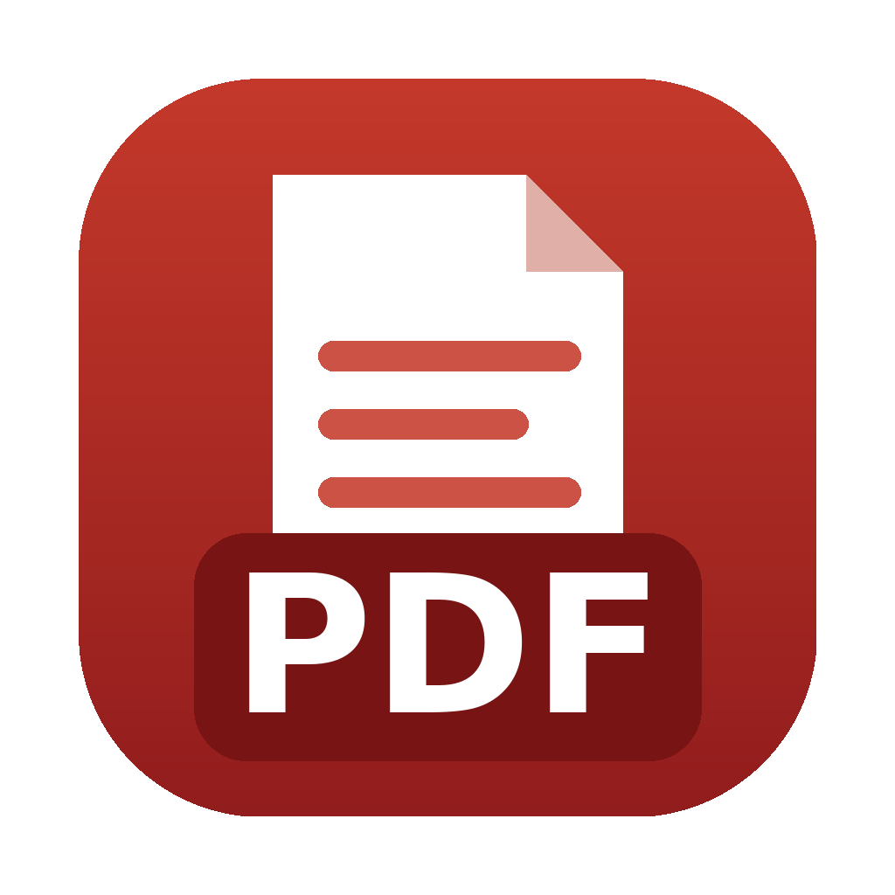

<div align="center">



# ARAEMKA PDF

**Herramientas PDF privadas, portables y 100 % locales.**

Comprimir · Unir · Dividir · Reordenar · Imágenes a PDF · PDF a Word · Limpiar metadatos

*José Ramón Alberto Alonso*

</div>

---

## Qué hace

ARAEMKA PDF es una aplicación de escritorio para Windows 10/11 (x64) y macOS
11 o posterior en equipos Apple Silicon (arm64). Trabaja con los archivos en el
propio equipo, sin cuentas, sin telemetría y sin enviarlos a servicios externos.

- **Comprime PDF** por lotes, con tres niveles de calidad y escala de grises opcional.
- **Convierte imágenes a PDF** individual o multipágina.
- **Une, divide y reordena PDF**, incluyendo rotación y extracción de páginas.
- **Convierte PDF a Word (`.docx`)** conservando texto, tablas e imágenes cuando la estructura lo permite.
- **Limpia metadatos** clásicos y XMP, EXIF de imágenes embebidas y, opcionalmente, anotaciones y formularios.

El archivo original nunca se sobrescribe: el resultado se guarda como una copia.

## Descargar

Las versiones publicadas estarán disponibles en
[Releases](https://github.com/jralbertoalonso-tech/ARAEMKA-PDF/releases).

1. Descarga el ZIP correspondiente a Windows o macOS.
2. Comprueba su huella SHA-256 publicada en la release.
3. Descomprime el paquete y abre `ARAEMKA-PDF.exe` o `ARAEMKA PDF.app`.

Los binarios todavía no están firmados por Apple o Microsoft. El sistema puede
mostrar una advertencia la primera vez. Verifica siempre el SHA-256 antes de
ejecutarlos.

## Límites importantes

- Una conversión de PDF a Word no puede garantizar fidelidad perfecta: revisa siempre el resultado.
- Los PDF escaneados sin capa de texto se incorporan al Word como imágenes; esta versión no realiza OCR.
- La limpieza cubre los metadatos y objetos compatibles, pero un archivo complejo puede contener información visible en sus páginas. Revísalo antes de compartirlo.
- La compresión puede no reducir archivos que ya estén optimizados.
- Los PDF protegidos con contraseña deben desbloquearse legítimamente antes de procesarlos.

ARAEMKA PDF organiza y limpia documentos, pero **no anonimiza su contenido
visible**. Para localizar y eliminar nombres, identificadores y otros datos
personales utiliza
[ARAEMKA Redact](https://github.com/jralbertoalonso-tech/ARAEMKA-Redact).

## Desarrollo

Requiere Python 3.11 o 3.12.

```bash
python3 -m venv .venv
source .venv/bin/activate
pip install -r requirements.txt
python run.py
```

Tests de lógica:

```bash
python -X utf8 tests_organizador.py
```

Prueba de interfaz en Linux con pantalla virtual:

```bash
xvfb-run -a python test_gui_smoke.py
```

Compilación con PyInstaller:

```bash
pyinstaller --noconfirm --clean ARAEMKA-PDF.spec
```

## Licencia

Copyright © 2026 José Ramón Alberto Alonso.

ARAEMKA PDF se distribuye bajo la **GNU Affero General Public License,
versión 3 exclusivamente** (`AGPL-3.0-only`). Consulta [LICENSE](LICENSE),
[CODIGO-FUENTE.md](CODIGO-FUENTE.md) y
[THIRD-PARTY-NOTICES.md](THIRD-PARTY-NOTICES.md).

Los nombres ARAEMKA y ARAEMKA PDF y sus logotipos no quedan licenciados como
marcas por la AGPL, salvo el uso descriptivo necesario para identificar el
programa. Consulta [TRADEMARKS.md](TRADEMARKS.md).
